  

# 🚀 Awesome Cloud CI/CD Automation

  
  
  
  
  
  

> 🌟 **Top Cloud CI/CD Automation & DevOps Tools (Open Source & Managed SaaS)** — Star if you find this valuable!

**A curated list and developer guide to modern Continuous Integration (CI), Continuous Delivery (CD), GitOps delivery engines, self-hosted runner infrastructure, and container-native pipeline orchestration.**

*Last updated: October 2026*

---

## 📑 Table of Contents

- [📊 Sector Overview & Market Dynamics](#-sector-overview--market-dynamics)
- [☁️ SaaS / Hosted Platforms](#️-saas--hosted-platforms)
- [🛠️ Open-Source GitHub Projects](#️-open-source-github-projects)
- [🤝 How to Contribute](#-how-to-contribute)
- [💖 Support & Sponsorship](#-support--sponsorship)
- [⭐ Star History](#-star-history)
- [⚠️ Disclaimer](#️-disclaimer)

---

## 📊 Sector Overview & Market Dynamics

The global **Continuous Integration & Continuous Delivery (CI/CD)** and pipeline automation market is estimated at **$10.38B – $13.2B in 2026**, expanding at a rapid **14% to 22% CAGR** powered by the global transition toward containerized microservices, multi-cloud Kubernetes architectures, and agentic AI-assisted developer workflows. 

The market dynamics exhibit a **two-tier structural ecosystem**:
- **Moderately Concentrated at the Enterprise Suite Tier**: Megascale platform suites—led by Microsoft (GitHub Actions & Azure DevOps), GitLab CI, and Atlassian (Bitbucket Pipelines)—dominate commercial enterprise adoption due to repository lock-in and bundled developer platform licenses.
- **Deeply Fragmented across Developer Implementation Layers**: Over **70% of engineering organizations** maintain self-hosted runners or multi-tool toolchains. Engineering teams continuously mix-and-match specialized continuous deployment orchestrators (such as Argo CD or Flux), container engines (Dagger, Earthly), and cost-effective self-hosted infrastructure (Jenkins, Woodpecker, Gitea Actions) to fulfill strict compliance, data sovereignty, and hardware optimization requirements.

---

## ☁️ SaaS / Hosted Platforms

Below is a detailed breakdown of industry-leading commercial CI/CD platforms. Entries are sorted descending by company size (valuation / revenue scale).

| Company / Product | Company Size (Revenue / Valuation) | Pricing (Starting Paid Tier) | Free Tier Limits | Key Highlights & Best For |
| :--- | :--- | :--- | :--- | :--- |
| **[Azure Pipelines](https://azure.microsoft.com/en-us/products/devops/pipelines)** (Microsoft) | ~$3.1T Market Cap (Parent: Microsoft; Azure DevOps ~$1B+ rev) | **$40/month** (per extra parallel job with unlimited minutes) | **1,800 build minutes/month** (1 parallel job, max 6 hrs/job) for private repos; 10 free parallel jobs with unlimited minutes for public repos | Deep enterprise integration with Microsoft Azure, AKS, and Azure DevOps services. |
| **[AWS CodePipeline](https://aws.amazon.com/codepipeline/)** (Amazon AWS) | ~$2.0T Market Cap (Parent: Amazon; AWS ~$105B+ ARR) | **$1.00/month** per active V1 pipeline (or $0.002/min for V2 actions) | **1 free active pipeline/month** (V1) or **100 action execution minutes/month** (V2); AWS CodeBuild includes 100 free build min/mo (general1.small) | Native integration with AWS IAM, ECS, EKS, and S3 deployments. |
| **[GitHub Actions](https://github.com/features/actions)** (Microsoft) | ~$100B+ Implied Value (Parent: Microsoft; GitHub ~$1.5B+ ARR) | **$4/user/month** (Team plan; includes 3,000 minutes/month, then $0.008/min for Linux 2-core) | **2,000 build minutes/month** and 500 MB storage for private repos; **100% free with unlimited minutes** for public open-source repos | The de facto cloud CI default; massive marketplace of prebuilt community Actions and reusable workflows. |
| **[Bitbucket Pipelines](https://bitbucket.org/product/features/pipelines)** (Atlassian) | ~$45B Market Cap (Parent: Atlassian; ~$4.4B annual rev) | **$3/user/month** (Standard plan; includes 2,500 build minutes/month pooled) | **50 build minutes/month** pooled across account; up to 100 self-hosted runners included | Seamless integration with Jira, Confluence, and the Atlassian project management suite. |
| **[GitLab CI](https://about.gitlab.com/)** (GitLab Inc.) | ~$9.2B Market Cap (NASDAQ: GTLB; ~$1.05B annual rev) | **$29/user/month** (Premium plan; includes 10,000 compute minutes/month) | **400 compute minutes/month** (shared runners) and 5 GB storage on Free tier; unlimited self-hosted runner execution | Complete single-application DevOps platform with built-in registry, security scans, and CI/CD Catalog components. |
| **[CircleCI](https://circleci.com/)** | ~$1.7B Valuation ($100M Series F; ~$60M ARR) | **$15/month** (Performance plan; includes 30,000 monthly credits + paid rollover credits) | **30,000 credits/month** (~3,000 Linux medium build minutes/month, max 5 active users, 30 concurrent jobs) | High-concurrency Docker-native pipeline execution with flexible machine shapes and speed caching. |
| **[Travis CI](https://www.travis-ci.com/)** (Idera, Inc.) | ~$300M+ Annual Rev (Parent: Idera, Inc.) | **$15/month** (Usage-based tier; 35,000 build credits, 80 concurrent jobs) | **14-day free trial** with **10,000 credits** (~1,000 Linux build minutes, 120-min max runtime); free credits for qualified OSS projects by request | Legacy hosted CI pioneer; straightforward `.travis.yml` declarative pipeline matrix testing. |
| **[Buildkite](https://buildkite.com/)** | ~$200M+ Valuation ($47M+ raised; ~$43M annual rev) | **$19/user/month** (Pro plan; unlimited jobs, teams, and priority support) | **Free tier** with up to **5 users**, **10 concurrent self-hosted agent jobs**, and **2,000 Linux AMD64 hosted minutes/month** (plus 30-day all-access trial) | Hybrid CI/CD combining secure self-hosted build runner agents with scalable cloud orchestration. |
| **[Semaphore](https://semaphoreci.com/)** (Rendered Text) | ~$26M Valuation (Bootstrapped; ~$3.7M ARR) | **$0.0075/minute** (Pay-as-you-go for 2 vCPU Ubuntu; modular add-ons from $50/mo) | **$15 in free credits/month** (~2,000 Ubuntu x64 2-vCPU minutes, 20 concurrent jobs, 100 GB artifact storage, 9.6 GB cache) | Extreme build execution speed, native Docker pipelines, and bare-metal performance with transparent per-minute billing. |

---

## 🛠️ Open-Source GitHub Projects

Explore the top open-source projects for self-hosted CI engines, GitOps controllers, and containerized runner automation. Entries are sorted descending by GitHub star count.

| Project | Stars | Tech Stack / Architecture | License | Key Strengths & Deployment Model |
| :--- | :---: | :--- | :--- | :--- |
| **[act](https://github.com/nektos/act)** |  | Go / Docker Engine | Apache-2.0 | **Run GitHub Actions locally** inside Docker containers to test workflows quickly without committing code or burning remote minutes. |
| **[Gitea](https://github.com/go-gitea/gitea)** |  | Go, Vue | MIT | **Lightweight self-hosted Git service with built-in CI/CD (Gitea Actions)** compatible with GitHub Actions YAML syntax and community actions. |
| **[Drone](https://github.com/drone/drone)** |  | Go / Docker Engine | Polyform / Apache-2.0 | **Container-native CI system** executing each pipeline step as an isolated Docker container with an extremely light memory footprint. |
| **[Jenkins](https://github.com/jenkinsci/jenkins)** |  | Java, Groovy | MIT | **The veteran self-hosted automation server** boasting 1,800+ plugins, distributed controller-agent architecture, and complex enterprise pipeline flexibility. |
| **[Argo CD](https://github.com/argoproj/argo-cd)** |  | Go, Kubernetes CRDs | Apache-2.0 | **The declarative GitOps continuous delivery standard for Kubernetes**, automating sync, drift detection, and multi-cluster deployment topology. |
| **[Dagger](https://github.com/dagger/dagger)** |  | Go, GraphQL, Multi-language SDKs | Apache-2.0 | **Programmable CI/CD engine** enabling pipelines written as real software code (Go, Python, TypeScript, Java) with native LLM/MCP workflow integration. |
| **[OneDev](https://github.com/theonedev/onedev)** |  | Java, TypeScript, Docker | MIT | **All-in-one self-hosted Git platform** with visual pipeline builder, Kubernetes executor, issue tracker, and deep code search. |
| **[Earthly](https://github.com/earthly/earthly)** |  | Go, BuildKit | Business Source License / Apache-2.0 | **Reproducible, containerized build automation tool** that combines the ergonomics of Dockerfiles and Makefiles; runs locally and in any CI. |
| **[Spinnaker](https://github.com/spinnaker/spinnaker)** |  | Java, Go, Python | Apache-2.0 | **Enterprise multi-cloud continuous delivery platform** originally built by Netflix for orchestrating complex blue/green, canary, and rolling deployments. |
| **[Tekton Pipelines](https://github.com/tektoncd/pipeline)** |  | Go, Kubernetes CRDs | Apache-2.0 | **Kubernetes-native standard framework** providing composable, declarative CRDs (Tasks, Pipelines, PipelineRuns) governed by the CD Foundation. |
| **[Flux 2](https://github.com/fluxcd/flux2)** |  | Go, Kubernetes CRDs | Apache-2.0 | **Open and extensible continuous delivery solution for Kubernetes** powered by the GitOps Toolkit; automates cluster state sync from Git/OCI repositories. |
| **[Woodpecker CI](https://github.com/woodpecker-ci/woodpecker)** |  | Go / Docker Engine | Apache-2.0 | **Simple, community-driven Docker-native CI server** (fork of Drone) featuring a modern web UI, multi-architecture agents, and effortless setup. |
| **[Concourse CI](https://github.com/concourse/concourse)** |  | Go, Elm | Apache-2.0 | **Highly opinionated, container-centric pipeline orchestrator** treating build steps as pure stateless functions over resources and jobs. |
| **[GoCD](https://github.com/gocd/gocd)** |  | Java, Ruby | Apache-2.0 | **Continuous delivery server specializing in complex dependency modeling** and first-class end-to-end Value Stream Mapping (VSM). |
| **[GitHub Actions Runner](https://github.com/actions/runner)** |  | C#, .NET | MIT | **Official self-hosted runner runtime for GitHub Actions**, enabling execution of GitHub workflows directly on private machines and clusters. |
| **[Flagger](https://github.com/fluxcd/flagger)** |  | Go, Kubernetes CRDs | Apache-2.0 | **Progressive delivery Kubernetes operator** that automates canary releases, A/B testing, and blue/green rollouts using service meshes and ingress metrics. |
| **[Agola](https://github.com/agola-io/agola)** |  | Go | Apache-2.0 | **Lightweight, cloud-native CI/CD service** engineered to run pipelines either directly in containers or on bare-metal worker nodes with minimal overhead. |

---

## 🤝 How to Contribute

Contributions are always welcome! Help keep this guide up-to-date with new tools, price changes, and architecture patterns:

1. 🍴 **Fork** this repository.
2. 🌿 Create a feature branch: `git checkout -b feature/new-tool`.
3. 📝 Update `README.md` following the tabular format (include tool name, website link, company metrics/stars, starting pricing tier, free tier limits, tech stack, and key strengths).
4. 🚀 Push changes and open a **Pull Request** with a brief summary.

---

## 💖 Support & Sponsorship

Thank you for exploring and using **Awesome Cloud CI/CD Automation**! 

If you find this repository helpful for your engineering team, side projects, or DevOps research, please consider supporting the maintenance of this project:

- ⭐ **Star this repository** to help others discover it across GitHub.
- 🍴 **Fork and share** it with your engineering colleagues and DevOps communities.
- ☕ **Buy me a coffee / Sponsor**: If you'd like to back further open-source research and tooling, you can sponsor through the **[GitHub Sponsors Dashboard](https://github.com/sponsors/ishandutta2007)**. Every bit of support is deeply appreciated!

---

## ⭐ Star History

---

## ⚠️ Disclaimer

- This repository is a **community-curated index** — provided for informational and architectural evaluation purposes.
- CI/CD platforms handling source code, build artifacts, and deployment secrets must strictly comply with industry data protection regulations (GDPR, SOC 2, HIPAA) and incorporate robust secret scanning and role-based access control (RBAC).
- **Architecture Distinction**: **GitHub Actions, GitLab CI, CircleCI, Bitbucket Pipelines, Azure Pipelines, AWS CodePipeline, Buildkite, Semaphore, and Travis CI** provide hosted runner clouds and managed SaaS orchestration. **Jenkins, Woodpecker, Gitea Actions, Tekton, Concourse, and GoCD** require self-hosted compute and database maintenance. **Argo CD** and **Flux 2** specialize in **GitOps continuous delivery**, while **Dagger** operates as a **programmable build engine**.
- Ensure any self-hosted or cloud runner deployment adheres to your organization's security baseline prior to automating production infrastructure.

---

  <b>Built with ❤️ for developers, DevOps engineers, and cloud architects worldwide.</b> 
  Let's make Cloud CI/CD Automation open, observable, and pipeline-friendly!

